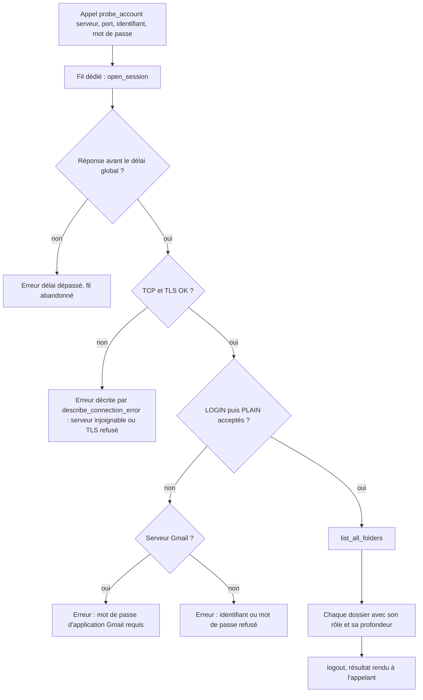
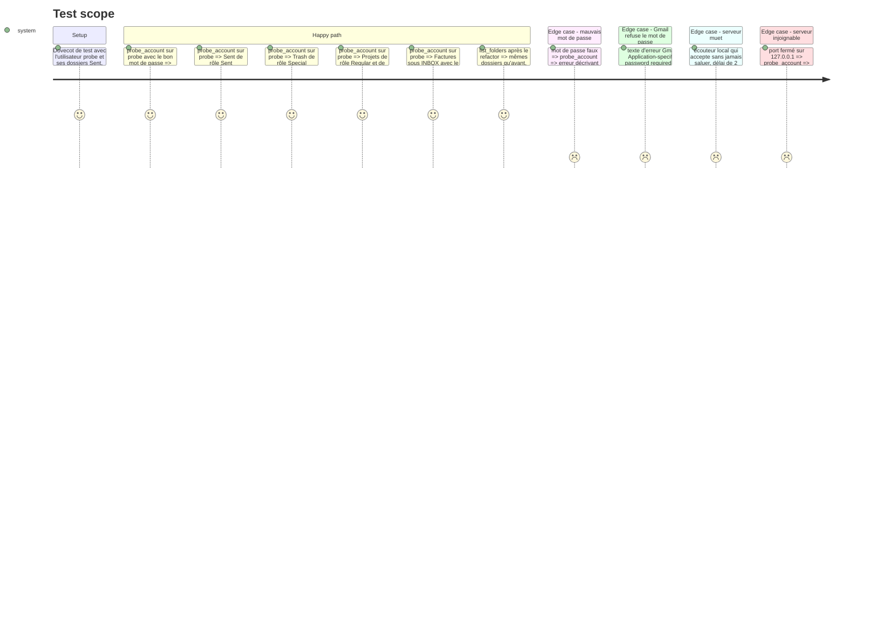

# Instruction: Sonde de connexion et liste complète des dossiers

## Architecture projection

> Tree of the final files. ✅ create · ✏️ modify · ❌ delete

```txt
.
├── src/
│   └── email_export.rs                         ✏️ fn open_session(…) extraite de connect(), list_all_folders() + FolderRole + ListedFolder,
│                                                  list_folders() réécrite par-dessus, fn probe_account(…) avec délai global, fn describe_connection_error(…), tests
├── tests/
│   ├── imap_integration.rs                     ✏️ tests probe_account sur Dovecot (dossiers, rôles, profondeur, mauvais mot de passe, serveur muet)
│   └── fixtures/imap/
│       ├── compose.yaml                        ✏️ utilisateur « probe » avec dossiers Sent, Trash, Projets et un sous-dossier Factures de INBOX
│       └── 99-contextual-test.conf             ✏️ special_use \Sent et \Trash sur les dossiers Sent et Trash
└── aidd_docs/memory/
    ├── architecture.md                         ✏️ sonde de connexion, rôles de dossiers, limite du délai
    └── testing.md                              ✏️ nouveaux tests et décompte
```

## User Journey



## Test Scope



## Tasks to do

### `1)` Ouverture de session sans `Account` complet

> Pouvoir se connecter avec quatre champs, sans construire un `Account` (dossier d'export, réglages…).

1. Dans `src/email_export.rs`, extraire de `ImapExporter::connect()` une fonction `fn open_session(server: &str, port: u16, username: &str, password: &str, debug: bool) -> Result<Session<Box<dyn ImapConnection>>>` : `ClientBuilder`, TLS non sécurisé seulement sous la variable de test et sur localhost, délai de lecture, LOGIN puis repli AUTHENTICATE PLAIN.
2. `connect()` appelle `open_session` puis garde le reste (`is_gmail`, stockage de la session) ; comportement de l'export inchangé.

### `2)` Liste complète des dossiers avec leur rôle

> Une seule source de vérité pour le filtrage SPECIAL-USE, réutilisée par l'export et par la sonde.

1. Ajouter `pub enum FolderRole { Inbox, Sent, Special, Regular }` et `pub struct ListedFolder { pub name: FolderName, pub role: FolderRole, pub depth: usize }`.
2. `list_all_folders()` : rend tous les dossiers sauf `\NoSelect` ; `INBOX` (insensible à la casse) → `Inbox` ; `\Sent` → `Sent` ; `\Junk`, `\Trash`, `\Drafts`, `\All`, `\Flagged`, `Important` (attribut ou nom `[Gmail]/Important`, `[Google Mail]/Important`) → `Special` ; le reste → `Regular`.
3. `depth` : nombre d'occurrences du séparateur hiérarchique rendu par `LIST` pour ce dossier (`/` chez Gmail, `.` en Maildir++ chez Dovecot) ; `0` si le serveur n'en déclare pas.
4. Réécrire `list_folders()` comme `list_all_folders()` sans les `Special` : mêmes dossiers rendus qu'aujourd'hui.

### `3)` Sonde de connexion bornée dans le temps

> Le bloc partagé par le formulaire de compte et l'import Thunderbird.

1. `pub fn probe_account(server, port, username, password, timeout: Duration) -> Result<Vec<ListedFolder>>` : lance `open_session`, `list_all_folders` puis `logout` best effort dans un fil dédié, et attend le résultat par `mpsc::Receiver::recv_timeout(timeout)`.
2. Pourquoi un délai global : `imap::ClientBuilder::connect` (3.0.0-alpha.15) appelle `TcpStream::connect` sans délai, puis lit le message d'accueil avant que `set_read_timeout` puisse être posé ; les fonctions TLS du crate sont privées. Un serveur qui accepte sans saluer bloquerait donc la sonde sans fin.
3. Délai dépassé : erreur « délai dépassé », fil abandonné. Il se termine quand la connexion TCP échoue ou se ferme ; face à un serveur qui accepte puis se tait sans fermer, le fil et son socket restent ouverts jusqu'à la fermeture de l'app. Cas rare, accepté : un fil par clic, sans effet sur l'interface. Constante `PROBE_TIMEOUT` (20 s) pour les appelants ; la limite est écrite dans `architecture.md`.
4. `pub fn describe_connection_error(server: &str, err: &anyhow::Error) -> String` en français, pour l'alerte : serveur injoignable, délai dépassé, TLS refusé, identifiant ou mot de passe refusé.
5. Serveur Gmail (`is_gmail_server`) et échec d'authentification : message dédié « Gmail exige un mot de passe d'application (validation en deux étapes activée) », avec l'adresse `https://myaccount.google.com/apppasswords` ; repérer aussi le texte `Application-specific password required` renvoyé par Gmail.
6. Tests unitaires inline de `describe_connection_error` sur des erreurs construites (Gmail, autre serveur, injoignable, délai dépassé).

### `4)` Fixture Dovecot

> Des dossiers spéciaux réels, pas un mock.

1. Vérifier d'abord ce que la configuration de l'image déclare (namespace inbox, séparateur, `special_use`), pour ne pas dupliquer le namespace.
2. `compose.yaml` : utilisateur `probe` avec les dossiers Maildir `Sent`, `Trash`, `Projets` et un sous-dossier `Factures` de `INBOX`, nommés selon la disposition Maildir de l'image ; un message dans `Projets`, réutilisé en phase 2.
3. `99-contextual-test.conf` : `special_use = \Sent` et `\Trash` sur `Sent` et `Trash` dans le namespace inbox.
4. Tests dans `tests/imap_integration.rs` : rôles et profondeurs attendus (le nom de `Factures` est construit avec le séparateur lu par `LIST`, jamais codé en dur), mauvais mot de passe, port fermé, serveur muet (`TcpListener` local qui accepte sans écrire, délai de 2 s).

### `5)` Mémoire projet

1. `architecture.md` : `open_session`, `list_all_folders`, `FolderRole` et `depth`, `probe_account` et la limite du fil abandonné.
2. `testing.md` : nouveaux tests et décompte.

## Test acceptance criteria

| Task | Acceptance criteria |
| ---- | ------------------- |
| 1 | Les tests d'intégration existants passent sans modification : `connect()` se comporte comme avant. |
| 2 | Sur l'utilisateur `probe`, `list_all_folders` rend `INBOX` en `Inbox`, `Sent` en `Sent`, `Trash` en `Special`, `Projets` en `Regular` de profondeur 0 et `Factures` sous `INBOX` en `Regular` de profondeur 1 ; `list_folders` rend les mêmes dossiers sans `Trash`. |
| 3 | `probe_account` avec le bon mot de passe rend la liste ; avec un mauvais, une erreur que `describe_connection_error` traduit en « identifiant ou mot de passe refusé ». Sur `imap.gmail.com`, le même échec donne le message sur le mot de passe d'application. Un serveur muet produit « délai dépassé » avant le délai plus 2 secondes. |
| 4 | `docker compose up` sur la fixture démarre sans erreur et les tests existants ne voient pas l'utilisateur `probe`. |
| 5 | `testing.md` liste les nouveaux tests et le décompte correspond à `cargo test --all-features -- --list`. |
