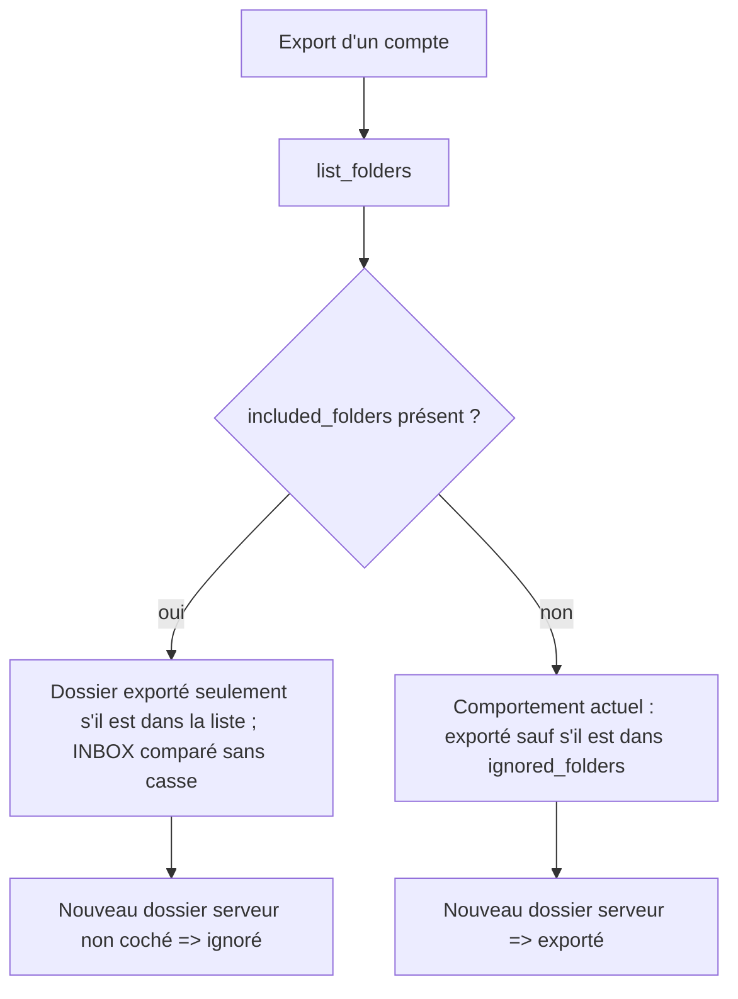
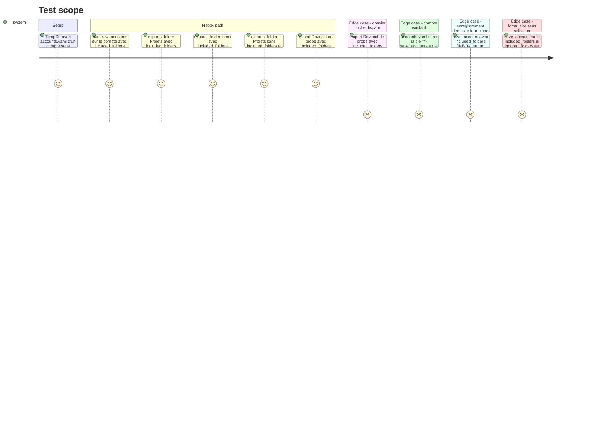

# Instruction: Liste d'inclusion des dossiers et sélection à l'export

## Architecture projection

> Tree of the final files. ✅ create · ✏️ modify · ❌ delete

```txt
.
├── src/
│   ├── config.rs                    ✏️ included_folders: Option<Vec<String>> sur RawAccount et Account, merge_account,
│   │                                   fn Account::exports_folder(&self, display: &str) -> bool, tests
│   ├── email_export.rs              ✏️ les trois filtres sur ignored_folders remplacés par exports_folder, constructeur de test
│   ├── thunderbird.rs               ✏️ write_accounts_merged recopie included_folders, constructeur de test
│   ├── server_cleanup.rs            ✏️ constructeur de test
│   └── tray/ipc.rs                  ✏️ AccountData.included_folders, save_account l'écrit et vide ignored_folders, tests
├── tests/
│   ├── rust_tests.rs                ✏️ config_tests : lecture, écriture et priorité de included_folders
│   └── imap_integration.rs          ✏️ export de l'utilisateur probe avec included_folders [INBOX]
└── aidd_docs/memory/
    ├── architecture.md              ✏️ sémantique inclusion contre exclusion
    └── testing.md                   ✏️ nouveaux tests et décompte
```

## User Journey



## Test Scope



## Tasks to do

### `1)` Nouvelle clé de configuration

> Coexister avec `ignored_folders` sans migration forcée.

1. `RawAccount` et `Account` : `included_folders: Option<Vec<String>>` avec `#[serde(default, skip_serializing_if = "Option::is_none")]`.
2. `merge_account` recopie le champ.
3. Mettre à jour les constructeurs littéraux d'`Account` / `RawAccount` (`email_export.rs` tests, `server_cleanup.rs`, `thunderbird.rs`, `tray/ipc.rs` tests).

### `2)` Règle de sélection unique

> Trois filtres identiques aujourd'hui : un seul helper (règle de trois).

1. `impl Account { pub fn exports_folder(&self, display: &str) -> bool }` : si `included_folders` est `Some`, vrai seulement si le nom y figure (`INBOX` comparé avec `eq_ignore_ascii_case`, les autres à l'identique) ; sinon vrai sauf si `ignored_folders` le contient.
2. `email_export.rs` : remplacer les filtres des lignes ~2437, ~2573 et ~3609 par `self.account.exports_folder(&folder.display)` ; le cas `only_folder` reste prioritaire.
3. Garder le `println!("Ignored folder: …")` de l'export complet.
4. Export complet : chaque nom de `included_folders` absent de `list_folders()` produit un avertissement `Selected folder not found on server: …` (dossier renommé ou supprimé côté serveur), sans faire échouer l'export.

### `3)` Écriture depuis le formulaire

> Préparer la phase 3 : enregistrer une sélection cochée.

1. `AccountData` : `included_folders: Option<Vec<String>>` (`#[serde(default)]`) ; `ignored_folders` passe de `Vec<String>` à `Option<Vec<String>>`, car la phase 3 retire les puces et le formulaire cessera de l'envoyer (avec `Vec` + `#[serde(default)]`, l'absence viderait la liste enregistrée).
2. `save_account` : `included_folders` `Some(liste)` → écrit la liste et vide `ignored_folders` ; sinon `ignored_folders` `Some` → l'écrit (comportement actuel) ; les deux `None` → aucune des deux clés ne change. Création : `ignored_folders` vaut `[]` si les deux sont absents.
3. L'import Thunderbird recopie `included_folders` dans `write_accounts_merged`.

### `4)` Tests

1. `tests/rust_tests.rs`, `config_tests` : aller-retour YAML, clé absente non écrite, `exports_folder` dans les quatre cas du Test Scope.
2. Tests inline de `save_account` dans `tray/ipc.rs` (TempDir).
3. `tests/imap_integration.rs` : export de l'utilisateur `probe` avec `included_folders: [INBOX]` → aucun fichier sous `Projets` (assertion exclusive), les messages de la boîte de réception présents (assertion inclusive) ; même export avec un dossier coché inexistant → succès et avertissement.

### `5)` Mémoire projet

1. `architecture.md` : clé `included_folders`, priorité sur `ignored_folders`, `exports_folder`.
2. `testing.md` : nouveaux tests et décompte.

## Test acceptance criteria

| Task | Acceptance criteria |
| ---- | ------------------- |
| 1 | Un `accounts.yaml` existant se charge et se réenregistre sans changement de contenu. |
| 2 | Avec `included_folders: [INBOX]`, l'export de `probe` ne crée rien sous `Projets` ; sans la clé, un compte exporte comme avant ; un dossier coché absent du serveur produit un avertissement et l'export réussit. |
| 3 | Après enregistrement d'une sélection, `accounts.yaml` porte `included_folders` et plus `ignored_folders` ; un enregistrement sans sélection laisse les deux clés intactes. |
| 4 | Tous les tests listés passent, dont l'intégration Dovecot. |
| 5 | `testing.md` correspond au décompte de `cargo test --all-features -- --list`. |
