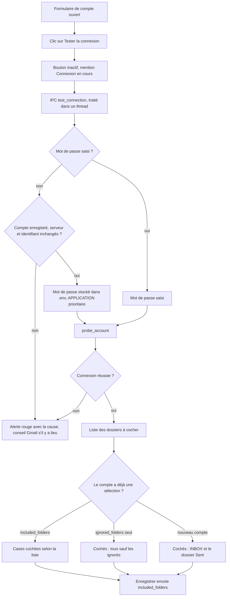
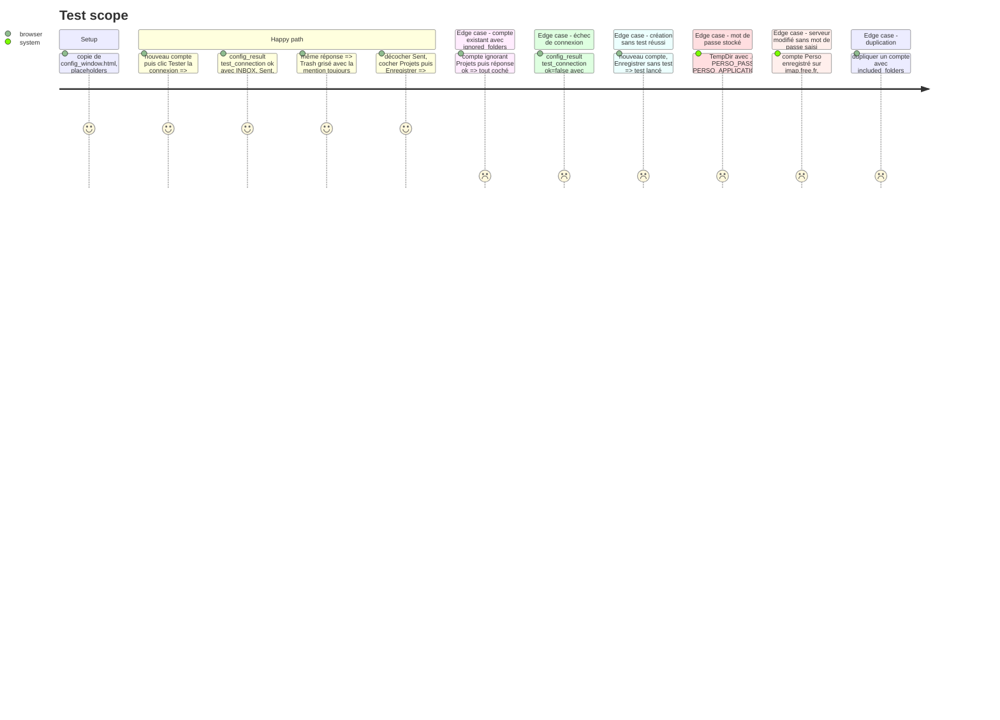

# Instruction: Formulaire de compte — bouton de test et dossiers à cocher

## Architecture projection

> Tree of the final files. ✅ create · ✏️ modify · ❌ delete

```txt
.
├── assets/
│   └── config_window.html           ✏️ bouton « Tester la connexion », liste de cases à cocher, alerte d'échec,
│                                       vérification avant création, puces de dossiers ignorés retirées
├── src/tray/
│   ├── ipc.rs                       ✏️ fn background_config_job(body) -> Option<job>, fn test_connection(data, accounts_path, env_path) -> String,
│   │                                   fn stored_password(env_path, account_name), tests
│   └── windows.rs                   ✏️ closure IPC Paramètres : job en arrière-plan via thread::spawn puis EvalScript, tests
└── aidd_docs/memory/
    ├── architecture.md              ✏️ IPC asynchrone de la fenêtre Paramètres
    └── testing.md                   ✏️ nouveaux tests et décompte
```

## User Journey



## Test Scope



## Wireframe

```txt
┌────────────────────────────────────────────────────────────────┐
│ (1) Modifier le compte                                         │
│     Serveur IMAP  [imap.gmail.com                ]             │
│     Port          [993]                                        │
│     Identifiant   [moi@gmail.com                 ]             │
│     Mot de passe  [••••••••                      ]             │
├────────────────────────────────────────────────────────────────┤
│ (2) [Tester la connexion]   Connexion réussie · 7 dossiers     │
├────────────────────────────────────────────────────────────────┤
│ (3) ⚠ cause de l'échec + conseil (mot de passe d'application)  │
├────────────────────────────────────────────────────────────────┤
│ (4) Dossiers exportés                                          │
│     [x] Boîte de réception                                     │
│     [ ]   INBOX/Factures                                       │
│     [x] [Gmail]/Messages envoyés                               │
│     [ ] Projets                                                │
│     [-] [Gmail]/Corbeille            toujours ignoré           │
│     [-] [Gmail]/Spam                 toujours ignoré           │
├────────────────────────────────────────────────────────────────┤
│ (5) Comportement (inchangé)                                    │
├────────────────────────────────────────────────────────────────┤
│ (6)                        [Annuler] [Enregistrer]             │
│     [Enregistrer quand même]                                   │
└────────────────────────────────────────────────────────────────┘
```

1. Champs de connexion existants, inchangés.
2. Bouton de test et état : en cours, réussi avec le nombre de dossiers, ou échec.
3. Alerte d'échec, visible seulement après un test raté ; reprend `describe_connection_error`.
4. Liste des dossiers, remplace les puces « Dossiers ignorés » ; sous-dossiers en retrait ; dossiers spéciaux grisés et non modifiables. Avant tout test : résumé de la sélection enregistrée et invitation à tester la connexion pour la modifier.
5. Bloc Comportement existant.
6. Boutons existants ; « Enregistrer quand même » n'apparaît qu'à la création, après un test raté.

## Tasks to do

### `1)` Canal IPC asynchrone de la fenêtre Paramètres

> Les actions réseau ne passent jamais par le traitement synchrone de `handle_config_ipc`.

1. `src/tray/ipc.rs` : `pub fn background_config_job(body: &str) -> Option<Box<dyn FnOnce() -> String + Send>>`, qui reconnaît `test_connection` (et les actions Thunderbird de la phase 5) et rend une fermeture produisant la réponse JSON.
2. `src/tray/windows.rs`, closure IPC de la fenêtre Paramètres : si `background_config_job` rend un job, `thread::spawn` → réponse → `EvalScript` `config_result(…)` avec `escape_json_for_script` ; sinon le chemin synchrone actuel.
3. `reply_changed_accounts` ne réagit pas à `test_connection`.

### `2)` Action `test_connection`

> Sonde à partir des champs du formulaire.

1. `fn stored_password(env_path: &Path, account_name: &str) -> Result<Option<String>>` : lecture du `.env` avec `dotenvy::from_path_iter`, `{NOM}_APPLICATION_PASSWORD` prioritaire sur `{NOM}_PASSWORD`, comme `config.rs`. Le job reçoit `config::env_file_path()`.
2. Garde-fou : le mot de passe stocké n'est utilisé que si le formulaire édite un compte existant (`create` faux, nom trouvé dans `accounts.yaml`) et que serveur et identifiant du formulaire sont identiques à ceux enregistrés (serveur comparé sans casse). Sinon : réponse en échec « saisissez le mot de passe », sans connexion. Un mot de passe enregistré ne part jamais vers un hôte tapé ou modifié.
3. `fn test_connection(data: &AccountData, accounts_path: &Path, env_path: &Path) -> String` : mot de passe saisi, sinon stocké sous le garde-fou, sinon réponse en échec « mot de passe manquant » ; puis `email_export::probe_account(…, PROBE_TIMEOUT)`.
4. Réponse : `{"action":"test_connection","ok":true,"folders":[{"name","role","depth"}]}` ou `{"ok":false,"message": describe_connection_error(…)}`. Le mot de passe n'apparaît jamais dans la réponse.
5. Les corps IPC portent des mots de passe : aucun `println!` ni journal de `debug` ne les affiche, dans le chemin asynchrone comme dans le synchrone.
6. Tests inline : `stored_password` (TempDir), garde-fou (serveur modifié → pas de connexion, réponse « saisissez le mot de passe »), forme de la réponse en échec.

### `3)` Liste de cases à cocher

> Remplacer la saisie de noms à la main.

1. Ajouter le bouton, la zone d'état, l'alerte et la liste ; retirer `#acct-chips`, `#acct-folder-input`, `#acct-folder-add`, `currentFolders`, `renderChips`, `editChip`, `addFolder`.
2. Branche `test_connection` dans `window.config_result` : cocher selon `included_folders`, sinon tous sauf `ignored_folders`, sinon `INBOX` et le rôle `Sent` ; `Special` grisé non modifiable.
3. Enregistrer : si la liste a été affichée, envoyer `included_folders` (dossiers cochés) ; sinon ne pas l'envoyer, la sélection enregistrée reste.
4. Toute modification de serveur, port, identifiant ou mot de passe masque la liste : il faut retester.
5. Duplication d'un compte (`showNewAccount(source)`) : recopie `included_folders` et `ignored_folders` de la source à la place de `currentFolders` ; le champ mot de passe reste vide, donc le test exige une saisie (garde-fou de la tâche 2).

### `4)` Vérification avant création

> « Ça ne sert à rien d'ajouter un compte si la connexion ne se fait pas. »

1. À la création, Enregistrer sans test réussi lance d'abord `test_connection`.
2. Succès : affiche la liste avec les cases par défaut, l'utilisateur ajuste puis enregistre.
3. Échec : alerte et bouton « Enregistrer quand même », qui enregistre avec `included_folders: [INBOX]`.

### `5)` Mémoire projet

1. `architecture.md` : `background_config_job` et la règle « réseau hors du gestionnaire IPC ».
2. `testing.md` : tests Rust ajoutés, procédure Playwright de `config_window.html` pour ce scénario.

## Test acceptance criteria

| Task | Acceptance criteria |
| ---- | ------------------- |
| 1 | Pendant un test de connexion vers un serveur muet, la fenêtre Paramètres et le menu de la barre des tâches restent réactifs. |
| 2 | Un compte existant dont le champ mot de passe est vide se teste avec le mot de passe du `.env`, `APPLICATION` prioritaire ; si son serveur ou son identifiant a été modifié dans le formulaire, aucune connexion n'est tentée sans saisie ; aucune réponse ni aucun journal ne contient le mot de passe. |
| 3 | Sur un compte Gmail réel, le test affiche les dossiers ; boîte de réception et messages envoyés cochés, corbeille et spam grisés ; après enregistrement, `accounts.yaml` porte exactement les dossiers cochés. |
| 4 | Créer un compte Gmail avec le mot de passe du compte (pas un mot de passe d'application) affiche l'alerte qui explique le mot de passe d'application ; « Enregistrer quand même » crée le compte avec la seule boîte de réception. |
| 5 | `testing.md` correspond au décompte de `cargo test --all-features -- --list`. |
