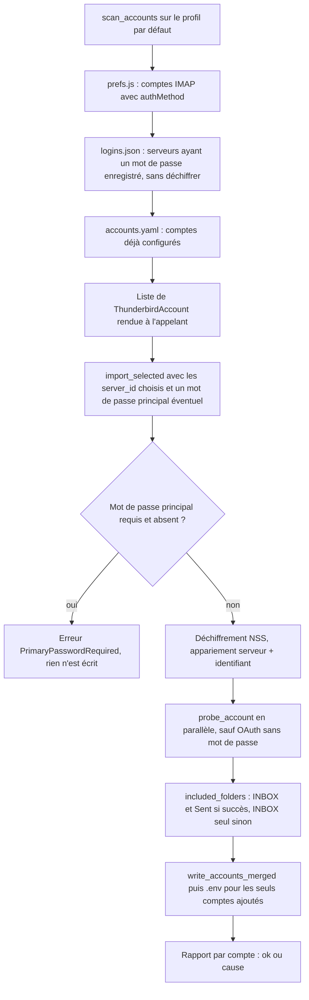
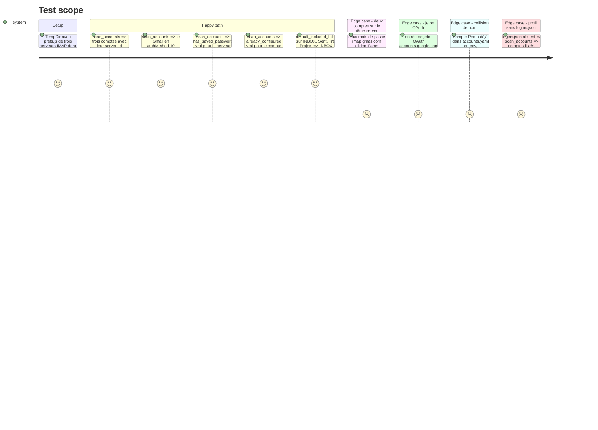

# Instruction: Thunderbird — inventaire des comptes, OAuth, mot de passe principal

## Architecture projection

> Tree of the final files. ✅ create · ✏️ modify · ❌ delete

```txt
.
├── src/
│   └── thunderbird.rs               ✏️ struct ThunderbirdAccount + enum AuthKind, fn scan_accounts(profile, accounts_path),
│                                       parse_prefs_js lit authMethod, PrimaryPasswordRequired, extract_passwords le détecte,
│                                       fn find_password(passwords, server, username), write_passwords_to_env apparie serveur et identifiant,
│                                       fn default_included_folders(&[ListedFolder]), fn import_selected(…), tests
└── aidd_docs/memory/
    ├── architecture.md              ✏️ import Thunderbird sélectif, détection OAuth, mot de passe principal
    └── testing.md                   ✏️ nouveaux tests et décompte
```

## User Journey



## Test Scope



## Tasks to do

### `1)` Inventaire sans déchiffrement

> Lister les comptes à cocher sans charger NSS ni exiger que Thunderbird soit fermé.

1. `pub enum AuthKind { Password, OAuth2, Other(u32) }` ; `parse_prefs_js` lit `mail.server.<id>.authMethod` (`10` → `OAuth2`, valeur à confirmer dans la source de Thunderbird avant d'implémenter).
2. `pub struct ThunderbirdAccount { server_id, account: Account, auth: AuthKind, has_saved_password: bool, already_configured: bool }`.
3. `pub fn scan_accounts(profile: &ThunderbirdProfile, accounts_path: &Path) -> Result<Vec<ThunderbirdAccount>>` : `has_saved_password` d'après les `hostname` en clair `imap://<serveur>` de `logins.json` ; `already_configured` avec la règle de `write_accounts_merged` (nom, ou serveur + identifiant).
4. `extract_accounts` (CLI) reste branchée sur le même parseur, sortie inchangée.

### `2)` Mot de passe principal

> Intégration prévue même si l'utilisateur actuel n'en a pas.

1. Erreur publique `PrimaryPasswordRequired` (thiserror), reconnue par `downcast_ref` côté appelant.
2. `extract_passwords` : après `NSS_Init`, si `PK11_NeedLogin` sur le slot interne est vrai et qu'aucun mot de passe n'est fourni, `NSS_Shutdown` puis `PrimaryPasswordRequired`.
3. Mot de passe fourni mais refusé : erreur distincte « mot de passe principal incorrect ».

### `3)` Appariement fiable des mots de passe

> Aujourd'hui, deux comptes Gmail reçoivent le même mot de passe (appariement sur le seul serveur).

1. `fn find_password<'a>(passwords: &'a [ThunderbirdPassword], server: &str, username: &str) -> Option<&'a ThunderbirdPassword>` : serveur et identifiant avec `eq_ignore_ascii_case`, repli sur le serveur seul s'il n'y a qu'une entrée pour ce serveur.
2. `write_passwords_to_env` l'utilise.

### `4)` Import d'une sélection avec vérification

> « Ça ne sert à rien d'importer des comptes si la connexion ne se fait pas. »

1. `pub fn default_included_folders(folders: &[ListedFolder]) -> Vec<String>` : noms des rôles `Inbox` et `Sent`.
2. `pub struct ImportReport { name, ok: bool, message: Option<String> }`.
3. `pub fn import_selected(profile, server_ids: &[String], primary_password: Option<&str>, accounts_path, env_path) -> Result<Vec<ImportReport>>` : comptes choisis seulement, et jamais un compte `already_configured` (revérifié ici sur `accounts.yaml` relu, pas seulement dans l'interface ; rapport « déjà configuré ») ; déchiffrement si au moins un a `has_saved_password` ; sondes `probe_account(…, PROBE_TIMEOUT)` lancées en parallèle (`std::thread::scope`, un fil par compte) pour que l'attente totale ne dépasse pas un seul délai ; puis `included_folders` (`default_included_folders` en succès, `[INBOX]` en échec) ; `write_accounts_merged` puis `write_passwords_to_env`.
4. `ImportSummary` gagne `added_names: Vec<String>` ; `write_passwords_to_env` ne reçoit que les comptes de `added_names`. Un compte écarté par la fusion (nom déjà présent) n'écrit donc jamais `{NOM}_PASSWORD` par-dessus le mot de passe d'un compte existant.
5. `extract_passwords` préfixe `PATH` par `env::set_var` (Windows seulement, où la bibliothèque standard sérialise l'accès à l'environnement) : sans risque depuis un fil du tray, mais ne préfixer que si le dossier n'y figure pas déjà, sinon `PATH` s'allonge à chaque import.
6. Compte OAuth2 sans mot de passe : pas de sonde, rapport en échec « compte Gmail connecté par OAuth dans Thunderbird : créez un mot de passe d'application ». Compte sans mot de passe enregistré : rapport « mot de passe absent de Thunderbird ».
7. Bloquant (n'écrit rien) : `PrimaryPasswordRequired`, échec de `NSS_Init` (Thunderbird ouvert), lecture du profil.

### `5)` Mémoire projet

1. `architecture.md` : inventaire, `AuthKind`, `PrimaryPasswordRequired`, appariement serveur + identifiant.
2. `testing.md` : tests ajoutés ; NSS et mot de passe principal en test manuel.

## Test acceptance criteria

| Task | Acceptance criteria |
| ---- | ------------------- |
| 1 | Sur le profil factice, `scan_accounts` rend les trois comptes, le Gmail marqué OAuth2, le bon `has_saved_password` et le bon `already_configured`, sans charger NSS. La sortie de `extract_accounts` ne change pas. |
| 2 | Test manuel : sur un profil protégé par un mot de passe principal, l'import sans mot de passe rend `PrimaryPasswordRequired` ; avec le bon, les mots de passe sont lus ; avec un faux, l'erreur « incorrect ». |
| 3 | Deux comptes sur `imap.gmail.com` reçoivent chacun leur propre mot de passe dans le `.env`. |
| 4 | Un import dont un compte porte le nom d'un compte existant laisse le `.env` de ce dernier intact (test TempDir sur `write_accounts_merged` + `added_names`). Test manuel sur le profil réel : un compte au mot de passe valide est importé avec boîte de réception et envoyés ; un Gmail OAuth est importé avec la seule boîte de réception et son rapport explique le mot de passe d'application. |
| 5 | `testing.md` correspond au décompte de `cargo test --all-features -- --list`. |
