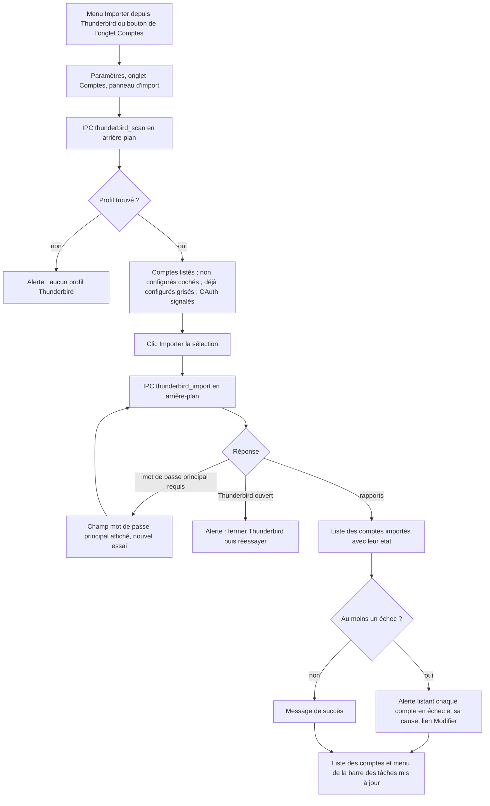
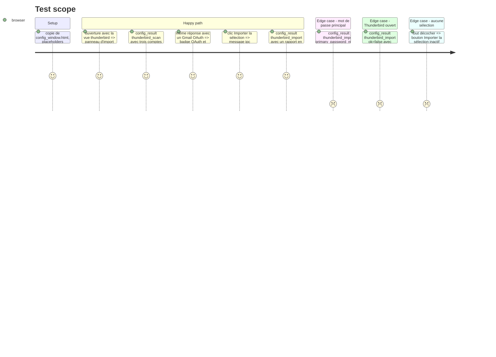

# Instruction: Import Thunderbird sélectif dans la fenêtre Paramètres

## Architecture projection

> Tree of the final files. ✅ create · ✏️ modify · ❌ delete

```txt
.
├── assets/
│   └── config_window.html           ✏️ bouton « Importer depuis Thunderbird », panneau de comptes à cocher,
│                                       champ de mot de passe principal, alerte de résultat, __INITIAL_VIEW__
├── src/
│   ├── tray/
│   │   ├── ipc.rs                   ✏️ jobs thunderbird_scan et thunderbird_import dans background_config_job, tests de forme des réponses
│   │   ├── windows.rs               ✏️ fenêtre Paramètres : vue initiale, thunderbird_import dans reply_changed_accounts, tests
│   │   ├── mod.rs                   ✏️ AppCommand::OpenConfig { sender, initial_view }
│   │   ├── event_loop.rs            ✏️ transmet initial_view à handle_open_config
│   │   └── menu.rs                  ✏️ IMPORT_THUNDERBIRD ouvre Paramètres sur le panneau d'import
│   └── tray_actions.rs              ✏️ action_import_thunderbird et run_import_thunderbird retirées (dialogue rfd à trois boutons)
└── aidd_docs/memory/
    ├── architecture.md              ✏️ parcours d'import depuis le tray
    └── testing.md                   ✏️ nouveaux tests, procédure manuelle d'import
```

## User Journey



## Test Scope



## Wireframe

```txt
┌────────────────────────────────────────────────────────────────┐
│ (1) Importer depuis Thunderbird            profil : default    │
├────────────────────────────────────────────────────────────────┤
│ (2) [x] Perso      imap.free.fr       moi@free.fr   🔑 trouvé  │
│     [x] Gmail      imap.gmail.com     moi@gmail.com OAuth ⚠    │
│     [-] Pro        mail.pro.fr        moi@pro.fr    déjà conf. │
├────────────────────────────────────────────────────────────────┤
│ (3) Mot de passe principal Thunderbird [••••••    ]            │
├────────────────────────────────────────────────────────────────┤
│ (4) ⚠ Gmail : OAuth dans Thunderbird, mot de passe             │
│       d'application requis                         [Modifier]  │
├────────────────────────────────────────────────────────────────┤
│ (5)                       [Annuler] [Importer la sélection]    │
└────────────────────────────────────────────────────────────────┘
```

1. En-tête du panneau et profil utilisé.
2. Comptes du profil : case, nom, serveur, identifiant, état (mot de passe trouvé, OAuth, déjà configuré). Déjà configurés grisés et non cochables.
3. Champ affiché seulement si l'import a répondu « mot de passe principal requis ».
4. Alerte de résultat : un compte en échec par ligne avec sa cause et un lien vers son formulaire (test de connexion de la phase 3).
5. Actions ; « Importer la sélection » inactif sans case cochée.

## Tasks to do

### `1)` Actions IPC d'import

> Brancher `scan_accounts` et `import_selected` sur le canal asynchrone de la phase 3.

1. `background_config_job` reconnaît `thunderbird_scan` (profil par défaut ayant un `prefs.js`, comme aujourd'hui, puis `scan_accounts`) et `thunderbird_import` (`server_ids`, `primary_password` facultatif, puis `import_selected`).
2. Réponses : `{"action":"thunderbird_scan","ok":true,"profile":…,"accounts":[…]}` ; `{"action":"thunderbird_import","ok":true,"reports":[…],"accounts":[liste relue]}` ; `PrimaryPasswordRequired` → `{"ok":false,"primary_password_required":true}` ; autre erreur → `{"ok":false,"message":…}`.
3. `reply_changed_accounts` : `thunderbird_import` réussi déclenche `RefreshMenu`.
4. Tests inline de la forme des réponses et de `reply_changed_accounts`.

### `2)` Panneau d'import

> Choisir les comptes au lieu de tout importer.

1. Bouton « Importer depuis Thunderbird » dans `.acct-list-head`, à côté de « Ajouter un compte ».
2. Panneau : liste cochable, défauts du Test Scope, champ de mot de passe principal masqué, alerte, boutons.
3. Branches `thunderbird_scan` et `thunderbird_import` dans `window.config_result` ; après import, `accounts = result.accounts` puis `renderAccountList()`, sans `populateGeneral()`.
4. Lien « Modifier » d'un compte en échec : ouvre son formulaire (`showAccountDetail(idx)`) pour corriger le mot de passe et tester.

### `3)` Entrée depuis le menu

> Le menu ouvre le même panneau ; l'ancien dialogue disparaît.

1. `AppCommand::OpenConfig { sender, initial_view: Option<&'static str> }` ; `event_loop.rs` le transmet ; la fenêtre remplace `__INITIAL_VIEW__` (`""` ou `"thunderbird"`).
2. Fenêtre déjà ouverte : la mettre au premier plan sur le panneau (`EvalScript` vers `showThunderbirdImport()`).
3. `menu.rs` : `IMPORT_THUNDERBIRD` envoie `OpenConfig { initial_view: Some("thunderbird") }`.
4. `tray_actions.rs` : retirer `action_import_thunderbird` et `run_import_thunderbird` ; l'import CLI ne change pas.

### `4)` Mémoire projet

1. `architecture.md` : parcours d'import depuis le tray, `__INITIAL_VIEW__`.
2. `testing.md` : tests ajoutés, procédure manuelle (profil réel, Thunderbird fermé puis ouvert, Gmail OAuth, mot de passe principal).

## Test acceptance criteria

| Task | Acceptance criteria |
| ---- | ------------------- |
| 1 | Un import réussi reconstruit le menu de la barre des tâches ; un mot de passe principal manquant rend une réponse dédiée sans rien écrire dans `accounts.yaml` ni `.env`. |
| 2 | Sur le profil réel, n'importer qu'un seul des comptes Thunderbird ajoute ce compte seul ; un compte déjà configuré ne peut pas être coché ; un échec de connexion apparaît dans l'alerte avec sa cause. |
| 3 | Le menu « Importer depuis Thunderbird » ouvre Paramètres sur le panneau d'import, y compris quand la fenêtre est déjà ouverte ; plus aucun dialogue `rfd` à trois boutons. |
| 4 | `testing.md` correspond au décompte de `cargo test --all-features -- --list` et décrit la procédure manuelle. |
